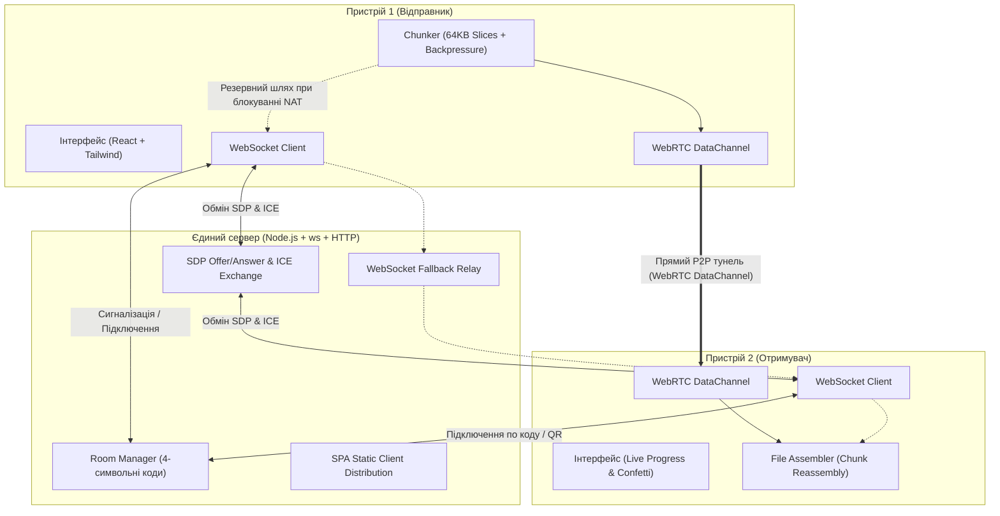
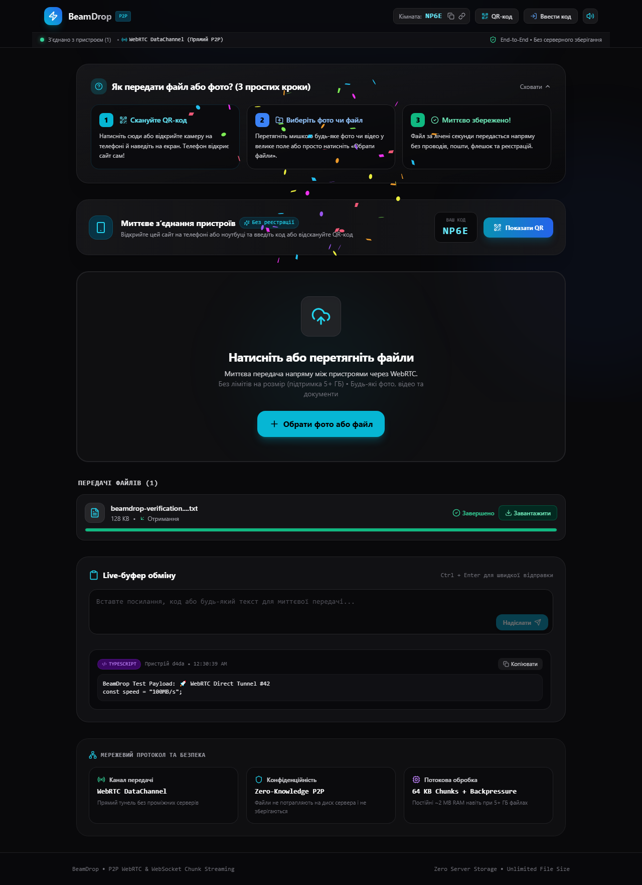
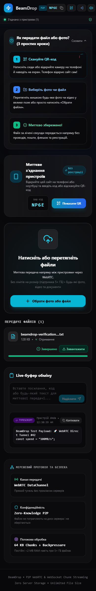

# ⚡ BeamDrop

> **Миттєвий P2P-обмін файлами та живим буфером обміну між будь-якими пристроями прямо у браузері.**
> *Instant browser-to-browser P2P file & live clipboard sharing without file size limits, registration, or server storage.*

[](https://vitest.dev)
[](https://playwright.dev)
[](#architecture)
[](#license)

---

## 🚀 Швидкий старт та зручність використання (Zero-Configuration UX)

1. **Автономний запуск у нативному вікні (Windows Launcher):**
   - Запуск додатку в один клік без необхідності вручну відкривати термінал чи вводити команди.
   - Окреме чисте вікно додатку з брендованою іконкою та контролем життєвого циклу процесів.
2. **Коректне керування процесами (Graceful Shutdown):**
   - При закритті вікна додатку (`[X]`) автоматично зупиняються всі фонові сервіси та звільняються зайняті мережеві порти.
3. **Безперебійна робота через будь-які типи мереж (NAT Traversal):**
   - Прямий захищений тунель без проміжних сторінок попереджень чи введення IP.
   - Підтримка високошвидкісних **TURN-серверів (OpenRelay)** для надійного пробиття суворих симетричних NAT та мобільних операторів (4G/LTE).
   - **Gzip-компресія** та довготривале кешування ассетів: інтерфейс завантажується за долі секунди навіть на мобільних пристроях із повільним з'єднанням.
   - **Бінарний WebSocket Fallback Relay:** потокова передача даних без оверхеду Base64 із динамічним контролем буфера (`backpressure`).
4. **Підтримка персонального статичного домену:**
   - Можливість налаштування постійного домену (Cloudflare Tunnel, ngrok тощо) у конфігурації `beamdrop.config.json` або безпосередньо через інтерфейс.
5. **Встановлення як PWA (Progressive Web App):**
   - Можливість зберегти додаток на головний екран смартфона (Android / iOS) в один дотик для швидкого щоденного доступу.
6. **Інтуїтивний 3-кроковий робочий процес:**
   - 📱 **Крок 1:** Сканування QR-коду або перехід за згенерованим посиланням.
   - 📂 **Крок 2:** Вибір файлу або тексту (Drag & Drop).
   - ✅ **Крок 3:** Миттєве отримання та збереження на цільовому пристрої.

---

## 🇺🇦 Огляд можливостей
1. **P2P передача файлів будь-якого розміру (Drag & Drop):**
   - Передача напряму між браузерами через **WebRTC DataChannels**.
   - Потокове розбиття на чанки по **64 KB** з автоматичним контролем протитиску (`backpressure` через `bufferedamountlow`).
   - Пам'ять браузера не перевищує **~2 МБ** навіть при передачі файлів розміром **5+ ГБ**!
   - Черга передачі кількох файлів одночасно, відображення швидкості (МБ/с) та залишкового часу (ETA).
2. **Live-буфер обміну (Drop Text / Code):**
   - Миттєва синхронізація тексту, посилань та фрагментів коду між пристроями.
   - Автоматичне розпізнавання синтаксису (TypeScript, Python, JSON, SQL, HTML, Shell, URL).
   - Кнопка «Копіювати в 1 клік» зі зворотним візуальним зв'язком.
3. **Автоматичний Fallback Relay:**
   - Якщо суворий NAT або корпоративний фаєрвол блокує прямий WebRTC P2P-канал, система автоматично перемикається на захищений потоковий ретранслятор через WebSocket.
4. **Преміальний UX у стилі Vercel / Linear:**
   - Темна естетична тема, плавні анімації, конфетті-салют при успішному отриманні файлу.
   - Синтезовані аудіо-ефекти (Web Audio API) без завантаження сторонніх MP3.

---

## 🏛️ Архітектура / Architecture



---

## 🚀 Варіанти запуску

### Варіант 1: Запуск у браузері
```bash
git clone https://github.com/Gogart33W/BeamDrop.git
cd BeamDrop
npm install
npm run build
npm start
```

### Варіант 2: Запуск через Docker
```bash
docker compose up --build -d
```
Сайт відкриється на порту `http://localhost:4000`.

---

## 🧪 Тестування / Testing

```bash
# Запуск 22 модульних тестів (Vitest)
npm test

# Запуск живого браузерного E2E-тесту (Playwright)
npm run test:e2e
```

---

## 📸 Скріншоти інтерфейсу / Screenshots

| Вкладка Отримувача з підказками та конфетті (Desktop) | Мобільний інтерфейс (iPhone / Android) |
|:---:|:---:|
|  |  |

---

## 🔒 Безпека та конфіденційність / Security & Privacy
- **Zero Server Storage:** Файли не зберігаються на сервері.
- **Шифрування DTLS/SRTP:** Вбудований стандарт WebRTC шифрує трафік end-to-end.
- **Без реєстрації:** Відсутні акаунти, форми та відстеження.
